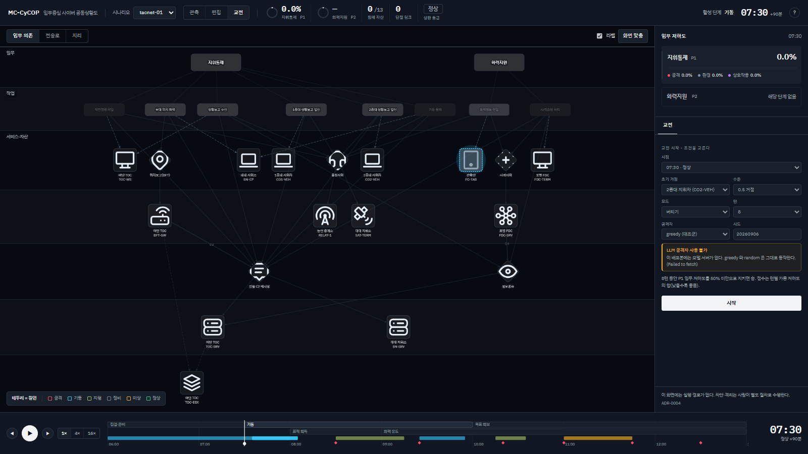
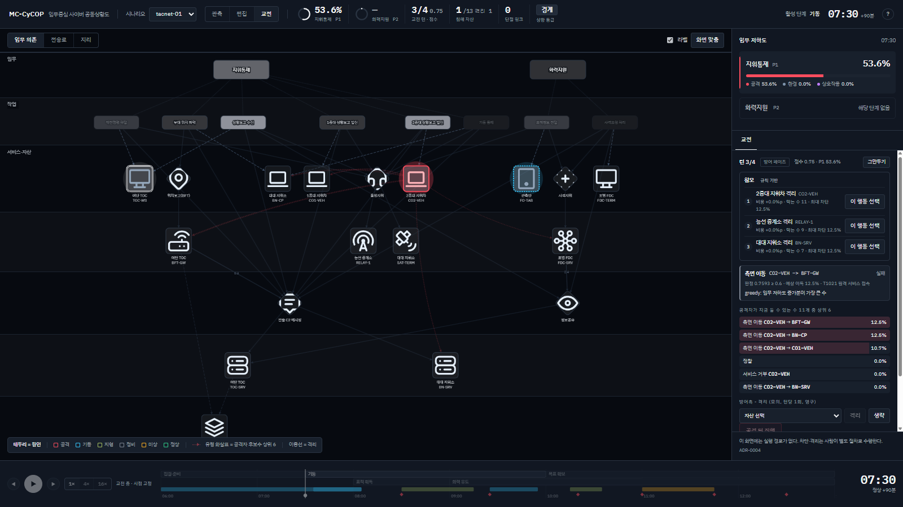
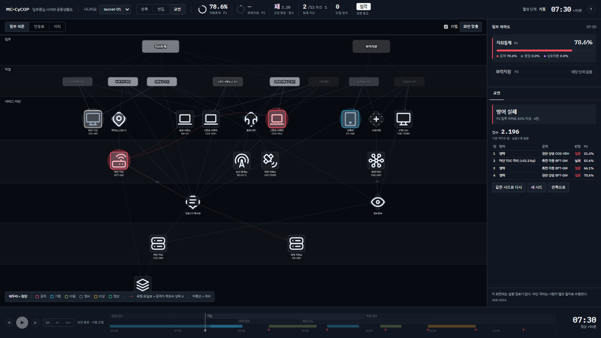

# 22. 교전 모드 - 규칙, 참모, 화면, 재현

**근거**: ADR-0026(교전 규칙), ADR-0019(공격자 엔진), ADR-0003/0004(모델은 상태를 정하지
않고 실행 경로는 없다)
**상태**: 구현 완료(2026-09-20, 브랜치 `ui/wargame-v2`). 설계 논의는
`docs/superpowers/specs/2026-09-20-wargame-v2-design.md`, 구현 결정은
`docs/design/decisions.md` "2026-09-20" 절.

---

코드는 `ui/src/game.js`(게임 코어, 순수 함수),
`ui/src/attack.js`(공격자 엔진), `ui/src/ui/Wargame.jsx`(패널), `ui/src/staff-llm.mjs`(참모
문장), `ui/src/derive.js` `gameOverlay`(그림에 올릴 파생값).

교전은 상황도 위에서 도는 **턴제 방어 훈련**이다. 방어자(사람)는 턴마다 자산 하나를
격리하거나 생략하고, 공격자(엔진 또는 모델)는 합법수 하나를 골라 시드 난수로 판정받는다.
임무 저하도는 관측 모드와 같은 결정론 엔진(`engine.js`)이 계산하므로, 양쪽이 같은 숫자
위에서 겨룬다. 실행 경로는 없다 - 격리는 모의 상태만 바꾼다(ADR-0004).

## 1. 규칙

| 항목 | 규칙 | 코드 |
|---|---|---|
| 시작 조건 | 시점 `t`(replay step), 초기 거점(자산 + 수준 0.5/0.8), 모드(hold/jewel), 턴 수(4/8/12), 공격자(greedy/random/LLM), 시드 | `startGame(g, cfg)` |
| 턴 순서 | 방어 페이즈(격리 1회 또는 생략) → 공격 페이즈(엔진이 수를 고르고 판정) → 평가. `turns` 회 반복 | `defend` / `pass` → `attackerTurn` → `evaluate` |
| 격리 - 임무 쪽 | 격리 자산은 `compromise = 1`(미가용)로 엔진에 들어간다. 대응 탭과 같은 엔진 what-if 를 쓰되, 게임의 비용은 임무 전체의 **우선순위 가중합**(Σ delta / priority)이고 대응 탭은 **가장 나빠지는 임무 하나의 delta** 를 보인다. 다른 임무의 delta 가 0 이 아니면 두 숫자는 다르다 | `compromiseOf(G)`, `isolationCost` |
| 격리 - 공격자 쪽 | 격리 자산은 공격자에게 **없는 자산**이다. 거점(`footholds`)·경유(`reachableFrom`)·표적(`legalMoves`) 전부에서 빠진다 | `attack.js` `opts.isolated` |
| 격리 횟수 | 턴당 1회, 영구. 되돌리는 행동은 없다 | `defend` 가 `phase === 'defend'` 에서만 동작 |
| 판정 | 합법수마다 성공 확률 `p`(정찰 0.95, 자격증명 탈취 0.7, 측면 이동 0.6, 권한 상승 0.65, 서비스 거부 0.8). `roll = rng(seed ^ hash(turn|move.id))`, `roll < p` 이면 성공 | `playTurn` |
| hold(버티기) 승패 | 마지막 턴 뒤 P1 임무 저하도 < 0.5 이면 승, 아니면 패 | `evaluate` |
| hold 점수 | `Σ_turns Σ_missions (저하도 × 1/priority)`. 턴마다 공격 판정 뒤의 값을 더한다. **낮을수록 좋다** | `weightedOf`, `score.perTurn` |
| jewel(보석 방어) 승패 | 공격자가 `crown_jewels` 중 하나를 1.0 으로 만들면 그 턴에 즉시 패. `turns` 턴을 버티면 승. **자기가 격리한 보석은 패가 아니다** | `evaluate` |
| jewel 점수 | `버틴 턴 × 100 − Σ 격리 비용 × 100`(정수로 반올림). 높을수록 좋다 | `score.total`, `score.isolationCost` |
| 재현성 | 같은 그래프·설정·행동 열이면 `history` 가 같다 | 시드가 화면에 보인다 |

침해 1.0 인 자산을 격리하면 임무 비용은 0 이고(이미 미가용이므로) 확산은 막힌다. 반대로
멀쩡한 자산을 격리하면 확산은 막지만 임무를 스스로 깎는다. 이 저울질이 게임이다. 아래
3절의 두 판이 정확히 그 대비다.

**격리 자산의 그림.** 엔진은 격리 자산을 미가용(침해 1)로 보지만 그것은 방어자의 표시이지
적의 효과가 아니다(ADR-0012). 그래서 그래프에서는 붉은 침해 칠 대신 무채 이중선 테두리,
지도에서는 `outage` 색 마커에 `is-isolated` 이중 링으로 그리고, 상단 띠의 "침해 자산" 칸은
격리 수를 빼고 센 뒤 `격리 N` 을 따로 붙인다. 즉 침해 자산 칸은 "침해이면서 격리 안 된
자산" 의 수다.

## 2. 참모

참모 카드는 **규칙이 매긴 순위표**다. 모델은 있으면 그 표를 읽어 주고, 없으면 표만 보인다.

### 2.1 순위 산식 (`staffTable`)

격리 안 된 자산 전부를 후보로 놓고, 후보 `id` 마다:

| 열 | 뜻 | 계산 |
|---|---|---|
| `cost` | 격리했을 때 임무가 얼마나 더 나빠지는가 | `weightedOf(격리 후) − weightedOf(격리 전)`, 즉 `Σ_missions delta / priority`. 같은 엔진 what-if(격리 = compromise 1)지만 대응 탭은 가장 나빠지는 임무 하나의 delta 를 보이므로 두 값은 다를 수 있다 |
| `blocks` | 공격자의 현재 합법수 중 몇 개가 사라지는가 | `legalMoves(isolated ∪ {id})` 에 없는 수의 개수 |
| `gainBlocked` | 사라지는 수 가운데 가장 큰 예상 이득 | `max(gain)` of 사라지는 수 |
| `net` | 순이익 | `gainBlocked − cost` |

정렬은 `net` 내림차순 → 동률이면 `blocks` 내림차순 → id. 상위 3 이 카드에 오르고 각 행의
"이 행동 선택" 버튼이 `defend()` 를 부른다. 버튼을 누르는 것은 사람이다.

### 2.2 사실 F# 과 모델 문장 (`staff-llm.mjs`)

모델(Ollama, `config.json` 의 `llm`)이 살아 있으면 "모델에게 읽게 하기" 버튼이 나타난다.
누르면 순위표를 사실 목록으로 바꿔 넘긴다:

```
F1: 턴 2/4, 모드 hold, 현재 P1 임무 저하도 21.4%     (턴 번호는 화면과 같은 1부터)
F2: 2중대 지휘차(CO2-VEH) 격리: 임무 비용 +0.0%p, 막는 공격 수 12개, 차단하는 최대 이득 16.1%, 순위 1
F3: 능선 중계소(RELAY-1) 격리: 임무 비용 +0.0%p, 막는 공격 수 10개, 차단하는 최대 이득 16.1%, 순위 2
...  (상위 5 까지, F6)
```

요구는 "한국어 2~3문장, 모든 문장은 `[F#]` 로 끝난다, 표에 없는 숫자를 쓰지 않는다,
JSON `{"advice": ...}` 하나". 문장은 `[F#]` 칩과 함께 그리고, 인용이 없는 문장에는
"미검증" 배지를 단다(ADR-0009). 카드 라벨은 `규칙 기반 + <모델명>` 이 되고, 문장 아래에
"표를 읽은 것이지 표를 만든 것이 아니다" 라고 적힌다. 모델 문장은 `history` 에 남지
않는다 - 상태가 아니다. 모델은 순위를 바꾸지도, 행동을 고르지도, 실행하지도 않는다
(ADR-0003/0004). 호출 실패는 카드 안에 오류 한 줄로 보이고 순위표는 그대로다.

## 3. 화면

세 장 모두 `?scenario=tacnet-01&t=90`(07:30, 기동 단계), 1600×900, 모델 서버 없음.

### 3.1 시작 카드 - `design/screens/2026-09-20-wargame-start.png`



교전 모드에 들어가면 우측 레일에 시작 카드가 뜬다. 시점은 현재 step(07:30) 이 기본이고
초기 거점은 저작된 공격 시간축이 처음 침해하는 자산(tacnet-01 은 CO2-VEH, 0.5)이 기본이다.
모델 서버가 없으면 공격자 셀렉트의 LLM 항목이 비활성이 되고 사유가 카드에 적힌다
(`이 배포본에는 모델 서버가 없다. greedy 와 random 은 그대로 동작한다`). 모드에 따라
카드 아래 한 줄이 승리 조건과 점수 방향을 말한다 - hold 는 "낮을수록 좋음", jewel 은
"버틴 턴×100 − 격리 비용".

### 3.2 진행 - `design/screens/2026-09-20-wargame-play.png`



hold, 4턴, greedy, 시드 20260906 의 3턴째 방어 페이즈다.

- 턴 1 생략 → 공격자가 `권한 상승 CO2-VEH` 를 골라 판정 0.0628 < 0.65 로 성공, P1 21.4%.
- 턴 2 여단 TOC 워크스테이션(TOC-WS) 격리(+32.1%p) → `측면 이동 CO2-VEH → BFT-GW`
  판정 0.7593 ≥ 0.6 으로 실패. P1 은 격리 비용 때문에 53.6%.

그림에 세 가지가 올라 있다. **유령 화살표**(빨강 저불투명도 점선)는 공격자의 현재 후보수
상위 6 중 자산 사이를 건너는 것 - CO2-VEH 에서 BFT-GW·BN-CP·CO1-VEH·BN-SRV·FDC-SRV 로,
이득 순으로 굵다. **이중선**은 격리한 TOC-WS 다. 아이콘은 붉은 침해 칠이 아니라 무채다.
**번쩍임**은 공격 판정 직후 0.8초 동안 표적 노드에 나타나므로 정지 화면에는 없다. 지도
뷰에서는 같은 정보를 마커(기기 아이콘)와 호로 그린다 - 격리 자산에 닿는 링크는 회색
실선(dead)이 된다.

상단 띠에 `3/4 0.75 · 교전 턴 · 점수` 칸이 생겼고, 침해 자산 칸은 `1/13 격리 1` 이다
(엔진은 TOC-WS 를 침해 1 로 보지만 띠는 격리를 따로 센다). 하단 시간축은
`교전 중 · 시점 고정` 이다 - 교전 중에는 시점을 옮길 수 없다. 우측 참모 카드는 CO2-VEH
격리를 1순위로 올렸다: 이미 1.0 인 자산이라 비용 0 에 남은 11개 수를 전부 막는다.

### 3.3 AAR - `design/screens/2026-09-20-wargame-aar.png`



위 판을 턴 3·4 생략으로 끝낸 결과. 공격자는 BFT-GW 로 측면 이동(성공)한 뒤 권한 상승
(성공)까지 갔고 P1 78.6% 로 끝나 **방어 실패**, 점수 2.196(가중 저하도 합). 턴별 표는
방어 행동과 비용, 공격 수, 판정, P1 을 한 줄씩 보인다. 상단 띠는 `패 2.20 · 교전 종료 ·
점수`, 시간축은 `교전 종료 · 시점 고정`. 버튼 셋: 같은 시드로 다시(설정 그대로 재시작),
새 시드(시드 +1), 관측으로.

같은 조건에서 **jewel 모드**로 턴 2 에 RELAY-1 을 격리한 판은 다르게 끝난다: 이 시각의
측면 이동은 전부 중계소를 거치므로 격리 뒤 공격자에게 남는 수는 `정찰`과 이득 0 인 자기
표적 수뿐이고, 4턴을 버텨 **방어 성공** 점수 400(4×100 − 격리 비용 0). 이것이 1절 끝의
대비다 - 이미 침해된 CO2-VEH 나 그 시각 임무 비용이 0 인 RELAY-1 을 격리하면 공짜로 확산이
멈추고, 멀쩡한 TOC-WS 를 격리하면 32%p 를 스스로 낸다.

## 4. 재현

**같은 시드 두 판은 같은 history 다.** `ui/src/__tests__/game.test.js` 의 "the same seed
and the same actions give the same history" 가 그것을 검사한다(같은 그래프·설정으로 두 판을
돌려 같은 행동 열을 넣고 `history` 를 `toEqual` 로 비교). 화면에서 확인하려면 AAR 의
"같은 시드로 다시" 를 누르고 같은 행동을 반복하면 된다 - 판정 값(`roll`)까지 같다.
LLM 공격자만은 예외다: 시드를 모델 서버에 넘기지만 서버가 같은 답을 보장하지는 않으므로,
재현 실험은 greedy/random 으로 한다. 판정 자체는 LLM 공격자여도 시드 난수다(ADR-0019).

```powershell
cd ui
npm test                       # vitest 43개: georef 8, derive 10, mapLayers 7, attack 5, game 13
node tools\parity.mjs          # attack.js 기본 경로(isolated 없음)가 PowerShell 참조와 같은가
```

`game.test.js` 13개가 다루는 것: 시작 상태와 기본 거점, `compromiseOf` 병합, 격리 비용 =
엔진 what-if delta, `defend` 의 페이즈 규칙, `attackerTurn` 의 history 누적, 재현성, hold
승/패와 점수, 턴 예산 전 미종료, jewel 즉시 패와 점수, 격리한 보석은 패가 아님(공격자가
갖고 있어도), `staffTable` 정렬과 격리 자산 제외.

`attack.js` 의 `isolated` 옵션은 기본값이 빈 배열이라 관측 모드의 공격 경로·비교 실험
(docs/13)은 한 값도 바뀌지 않는다. `parity.mjs` 가 그것을 매번 확인한다.

## 5. 알려진 한계

- **방어 행동이 격리 하나다.** 패치·기만·우회 경로 같은 행동은 없다. 그래서 방어의
  질문은 "무엇을, 언제 끊을 것인가" 하나로 좁혀져 있고, 참모 순위표도 그 질문만 답한다.
- **LLM 공격자와 LLM 참모는 Ollama 가 필요하다.** `config.json` 의 `llm.endpoint` 에 서버가
  없으면 공격자 셀렉트의 LLM 이 비활성이 되고 참모는 순위표만 보인다. greedy/random 과
  규칙 참모는 오프라인에서 그대로 돈다.
- **hold 와 jewel 의 점수 방향이 다르다.** hold 는 누적 저하도라 낮을수록 좋고, jewel 은
  버틴 턴 기반이라 높을수록 좋다. 두 모드의 점수를 서로 비교하면 안 되며, 시작 카드와
  AAR 에 방향을 명시한 이유가 이것이다. 상단 띠의 점수 칸은 방향을 적지 않으므로 모드를
  알고 읽어야 한다.
- **격리 자산의 원인 분해가 없다.** 엔진에 '격리' 원인을 넣지 않았으므로 격리 자산의
  임무 영향은 대응 탭과 같이 침해(attack) 항목으로 합산된다. 원인 색 8종과 PowerShell
  참조 대조를 지키기 위한 선택이다(ADR-0026 "하지 않는 것").
- **시작 시점의 침해 상태는 물려받지 않는다.** 시작 카드는 시점 `t` 의 환경(단절·기동·
  지형)만 가져오고 공격자 상태는 초기 거점 하나로 시작한다. 저작된 공격 체인이 이미
  진행된 시점(예: 12:30)에서 시작해도 공격자는 거점 하나뿐이다.
- **교전 중에는 시간축이 잠긴다.** 시점을 옮기려면 그만두기나 AAR 을 거쳐야 한다. 모드를
  바꾸거나(편집·관측) 시나리오를 바꾸면 게임은 초기화된다 - 게임은 시작한 그래프와 시점에
  속한다.
