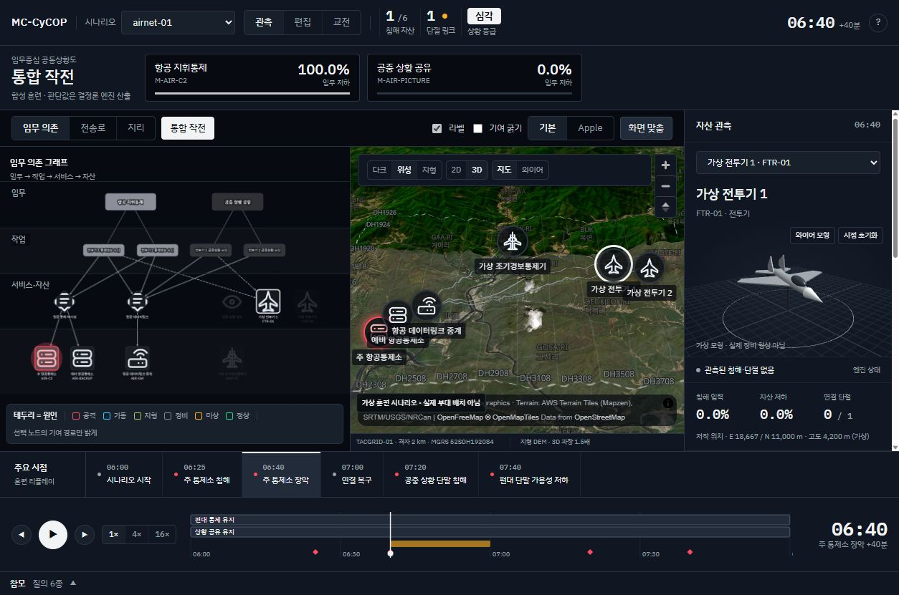

# 통합 작전 화면과 항공 합성 시나리오

2026-11-10. 작업 기준 `a71eace`, 브랜치 `codex/mission-operations-studio`.
클로드의 SOC 작업과 별도 worktree에서 진행한다.

사용자 제공 74.75초 영상에서 참고한 것은 동기화된 분할 화면, 선택 플랫폼 3D,
시간 이동과 상태 추이다. 영상 파일과 타사 3D 자산은 저장소에 포함하지 않는다.

## 구현 범위

- 기존 임무 의존 그래프가 기본이다. `통합 작전`으로 그래프와 보조 지도를 나란히 연다.
- 같은 선택과 같은 엔진 step을 그래프, 지도, 3D 자산 정보에 사용한다.
- 기체·장비 모형은 자체 저작한 절차적 도형이다. 형상·축척·항적은 가상이며,
  비행역학·센서 탐지·무장 운용 모델을 의미하지 않는다.
- `airnet-01`은 가상 전투기 둘, 조기경보통제기 하나, 통제 서버 둘, 데이터링크
  게이트웨이 하나로 구성한다. 항공 플랫폼의 사이버 단말이 임무 그래프의 자산이다.
  `type`은 기존 사이버 장비 유형을 유지하고 `visual_model`은 표시 메타데이터다.
- 시계와 경로는 저작한 훈련 시간이다. 실제 비행 속도나 항공 성능을 주장하지 않는다.
- 합성 데이터는 개발·회귀·구성 타당성 확인 전용이다. 탐지 성능 평가에 쓰지 않는다.

## 생성 전에 확정한 산출물

1. `scenarios/airnet-01/mission.json`: 6자산, 2임무, 서비스·작업 의존, 시간축,
   자산 위치·항적, 저작된 환경 단절. 기존 tacnet 지리 앵커만 재사용.
2. `attack-timeline.json`: 침해 입력과 ATT&CK 서술 라벨. 환경 단절을 섞지 않는다.
3. `MANIFEST.json`: 입력 파일/생성기 SHA256, 코드 기준 버전, 자체 저작 출처,
   재배포 조건, 생성 파라미터, 산출물 해시.
4. `ui/public/data/airnet-01.replay.json`: 기존 PowerShell 결정론 엔진이 출력한
   자산·서비스·작업·임무 저하와 what-if. JS 엔진과 parity 검증한다.
5. `ui/public/data/airnet-01.provenance.json`: 원본 시나리오·생성기·참조 엔진·내보내기
   스크립트와 결과 파일 해시. `--record-replay`가 그래프 일치 확인 후 기록한다.

외부 데이터셋 취득·원본 수정·삭제는 없다. 생성기는 Python 표준 라이브러리만 쓴다.

## 실행

커밋된 리플레이로 바로 실행할 수 있다. 저장소 루트에서:

```powershell
cd ui
npm.cmd ci
npm.cmd run dev -- --port 5187 --strictPort
```

시연 주소: `http://localhost:5187/?scenario=airnet-01&studio=1&t=40&select=FTR-01`.
`studio=1`은 넓은 화면의 관측 모드에만 적용한다. 모바일·편집·교전에서는 기존 화면을 쓴다.

시나리오 입력을 수정하고 리플레이를 재생성할 때는 저장소 루트에서:

```powershell
& "$env:LOCALAPPDATA/Programs/Python/Python312/python.exe" scripts/build_airnet_demo.py
.\scripts\Export-ReplayData.ps1 -Scenario scenarios/airnet-01/mission.json -Out ui/public/data/airnet-01.replay.json
& "$env:LOCALAPPDATA/Programs/Python/Python312/python.exe" scripts/build_airnet_demo.py --record-replay
```

## 검증 포인트

전투기와 조기경보통제기 선택, 모형 회전·와이어·초기화, 주요 시점 이동,
임무 수치 동기화, 원인 분리, what-if에서 기존 승인 건의 패널 연결,
기존 두 시나리오 회귀, 작은 화면, 지도 타일 실패 시 표시, WebGL 실패 시 정보 유지.

현재 3D는 선택 자산의 관측 모형이다. 항공 마커는 지도 평면에 투영하고 고도는
자산 정보에서 표시한다. 기체 모형이 지도 위 실제 고도에서 비행하는 렌더러는 아니다.
airnet은 공중전 교전규칙을 추가하지 않는다. 기존 교전은 사이버 추상 모델이다.

## 확인 결과 (2026-11-10)

- 단위 495/495, PS/JS parity 2,222개 값 불일치 0, 시나리오 불변식 3,103건 실패 0.
- 오프라인 게이트 11/11 통과. 데이터·모델 티어는 실행하지 않았다.
  [게이트 결과](../eval/results/operations-studio-gates-2026-11-10.json).
- 프로덕션 빌드 통과. 3D 지연 청크 gzip 148.23 kB. Vite의 500 kB 청크 크기 경고는 남아 있다.
- 브라우저에서 전투기/조기경보통제기 선택, 모형 드래그·와이어·초기화, 지도 선택 동기화,
  사건 이동·링크 복구, 기존 승인 건의 패널 연결, tacnet/defnet 전환을 확인했다.
- 1600px·1254px 분할 화면과 390px 단일 화면을 확인했다. SVG 지도의 크기 증가 루프와
  그래프/범례 겹침을 수정했다. 확인한 세션의 브라우저 콘솔 error는 0건이다.
- 타일 장애와 WebGL context 실패를 강제로 주입하는 검사는 수행하지 않았다.


