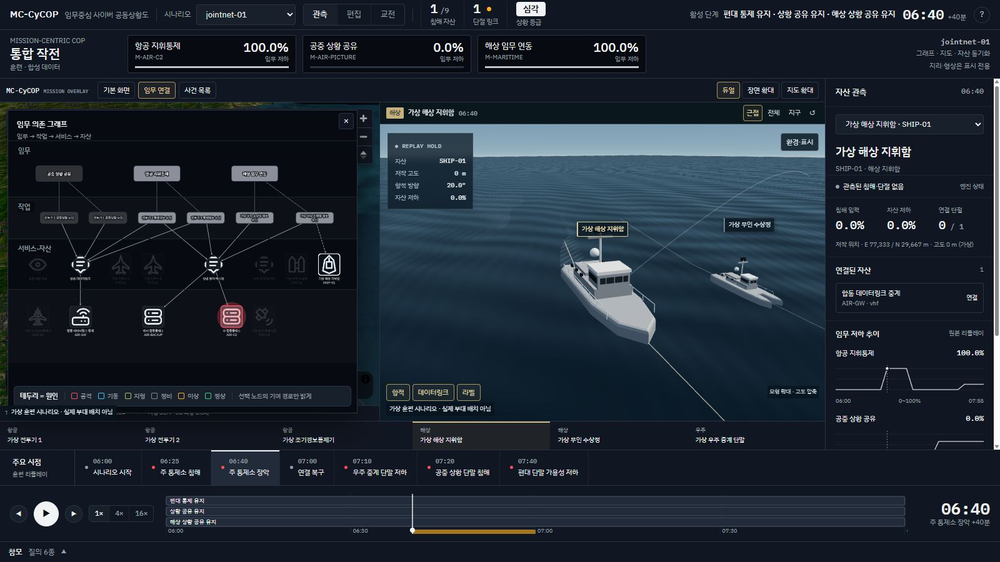
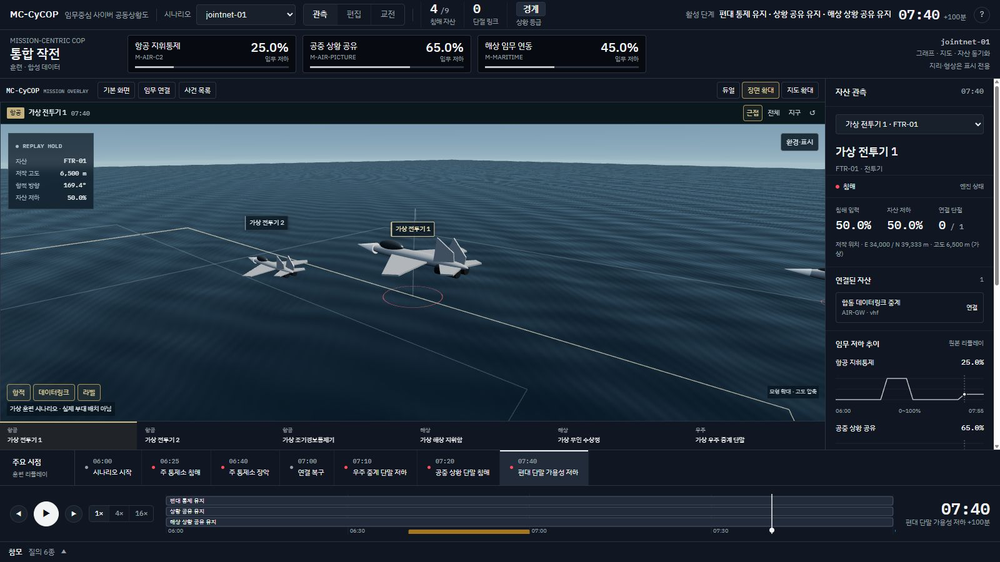
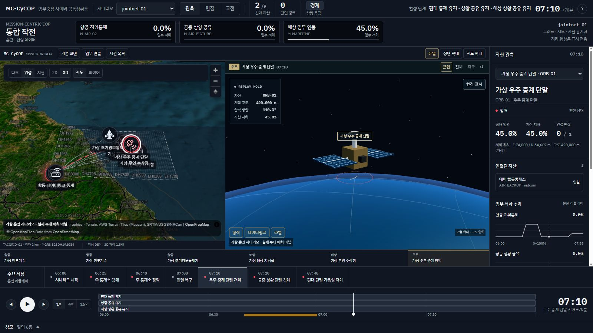

# 영상 장면 위의 MC-CyCOP

2026-11-10. 두 번째 제공 영상(16-22-00, 141.52초)을 기준으로 한다.
사용자의 의도는 작은 모형 패널 추가가 아니라, 지도와 움직이는 플랫폼 장면을 바탕으로
MC-CyCOP의 임무 상태·사이버 영향·대응 판단을 겹쳐 보는 경험이다.

## 화면 대응

| 영상에서 확인한 구성 | 구현할 MC-CyCOP 경험 |
|---|---|
| 0~28초: 지도 + 큰 함정 3D + 오른쪽 정보 | 듀얼 지도/장면, 자산 선택 동기화, 엔진 상태 패널 |
| 32~52초: 지구 곡면과 우주 플랫폼 | 지구 시점과 가상 우주 중계 단말, 표시용 항적 |
| 56~78초: 장면 확대와 해면·환경 조절 | 함정/수상정·항공 근접 장면, 파면·시정·주야 표시 설정 |
| 88~136초: 다중 자산·연결·작전 단계 | 편대/전체 시점, 전송 링크·항적 토글, 공통 리플레이 시계 |
| 단계 목록·차트·승인 패널 | 기존 결정론 엔진의 임무 저하·원인·what-if와 사람 승인 건의 연결 |

원본의 실제 장비 제원·발사/추력/교전 물리, 실시간 AIS/ADS-B/TLE 데이터는 이 저장소에
존재하지 않는다. 이를 추정해서 수치·성능·실시간이라는 이름으로 보여 주지 않는다.
영상 파일 자체를 배경으로 재생하거나 원본 UI 코드를 복제하는 구현도 아니다.

## 생성 전에 확정한 산출물

- `jointnet-01/mission.json`: 항공 시나리오에 해상 지휘함, 무인 수상정, 우주 중계 단말을
  더한 9자산·3임무의 합성 구성. 사이버 유형은 기존 스키마, 모형은 표시 메타데이터.
- `attack-timeline.json`: 기존 통제소 침해/환경 단절과 우주 중계 단말 저하를 분리한 입력.
- `MANIFEST.json`: 입력·생성기·엔진·리플레이의 SHA256, 자체 저작 출처와 사용 범위.
- `jointnet-01.replay.json` 및 `.provenance.json`: 기존 PowerShell 엔진 산출과 출처 기록.
- 모형·파면·구름·지구 셰이더: 자체 저작 코드. 외부 데이터셋·텍스처·모형 취득은 없다.

## 불변 조건

일반 진입의 기본 뷰는 기존 임무 그래프다. 사용자가 고르는 `통합 작전` 안에서만
시각 장면을 넓히고 의존 그래프를 겹쳐 여는 형태를 쓴다. 상태와 what-if는 같은 엔진
출력이다. 시점·파면·시정·주야·형상·고도는 판단값에 영향을 주지 않는다.
모바일에서는 기존 단일 화면으로 돌아간다. 훈련 워터마크는 항상 남긴다.

## 실행과 사용

저장소 루트에서 `cd ui`, `npm.cmd ci`, `npm.cmd run dev -- --port 5187 --strictPort`.
직접 진입 주소는 `http://localhost:5187/?scenario=jointnet-01&studio=1&t=40&select=SHIP-01`.
일반 진입에서는 `jointnet-01` 선택 후 `통합 작전`을 누른다.

- `듀얼 / 장면 확대 / 지도 확대`: 지도와 3D의 배치 전환.
- 하단 플랫폼 버튼·지도 마커·3D 라벨·오른쪽 자산 선택은 같은 선택 상태를 바꾼다.
- `근접`: 선택 자산 영역. 함정은 해면, 항공은 공중, 우주 단말은 지구 곡면 위,
  지상 장비는 관측 격자에 표시한다. `전체`는 축약 배치, `지구`는 지리 격자 관측이다.
- 드래그/휠로 회전·확대하고 `↺`로 초기화한다. 지구 시점은 지리 앵커가 있을 때만 가능하다.
- `임무 연결 / 사건 목록`은 장면 위 분석 패널이다. `기본 화면`으로 기존 분석 화면에 돌아간다.
- `환경·표시`에서 파면·연무·주야·와이어를 바꾼다. 항적·데이터링크·라벨도 켜고 끈다.
- 재생·정지·배속과 사건 이동은 기존 공통 시간축을 쓴다. 환경은 재생 중에만 움직이고,
  브라우저가 숨겨졌거나 감소된 동작을 요청한 경우 반복 렌더링을 멈춘다.

시나리오 재생성 (저장소 루트):

```powershell
& "$env:LOCALAPPDATA/Programs/Python/Python312/python.exe" scripts/build_jointnet_demo.py
.\scripts\Export-ReplayData.ps1 -Scenario scenarios/jointnet-01/mission.json -Out ui/public/data/jointnet-01.replay.json
& "$env:LOCALAPPDATA/Programs/Python/Python312/python.exe" scripts/build_jointnet_demo.py --record-replay
```

## 검증과 한계

- 단위 508개 통과. PS/JS 비교 3,182개 값 불일치 0. 시나리오 불변식 4,389건 실패 0.
- 프로덕션 빌드 및 오프라인 게이트 11/11 통과.
  [결과 JSON](../eval/results/immersive-operations-gates-2026-11-10.json).
  데이터/모델 티어는 실행하지 않았다. Vite의 큰 청크 경고는 남아 있다.
- 지리 범위를 확장하면서 모서리의 고정 위도 근사 오차 약 972m를 확인했다.
  매니페스트가 참조하는 시나리오에는 표시 허용 오차 1,100m를 선언한다. 항법 정보가 아니다.
- `airnet-01`, `jointnet-01` 전용 이야기 검증은 단위 테스트가 담당한다.
  공통 불변식 검사기의 미등록 story NOTE 두 건은 실패가 아니다.
- 원본 영상과 동일한 물리 시뮬레이터·실시간 센서 화면이라고 주장하지 않는다.
  모형 축척·고도 압축·수면·대기·지구 격자는 자체 저작 표현이다. 지구의 실사 텍스처는 없다.
  파면/연무 슬라이더는 실측 풍속·파고·탐지거리나 상태 판정에 대응하지 않는다.
- 지도 타일은 기존 공용 타일 설정을 사용한다. 타일 장애와 WebGL context 실패의
  강제 주입, 장시간 GPU 부하 측정은 이번 검증 범위 밖이다.

## 브라우저 확인

1600×900과 기본 1280×720에서 듀얼/확대 배치, 근접/전체/지구 시점,
카메라 회전, 자산 선택 동기화, 사건 이동과 재생/정지를 확인했다.
야간·와이어·파면을 바꿔도 임무 값은 유지됐다. 기존 대응 패널의 승인 요청 화면까지
연결을 확인했으며 대응을 실행하지 않았다. 지리 앵커가 없는 시나리오는 지구 시점을
비활성화하고 지상 장비 관측을 제공한다. 390×844에서는 기존 단일 화면으로 전환됐다.
최종 1280×720에서 문서 크기도 1280×720이며 브라우저 오류 로그는 0건이었다.




